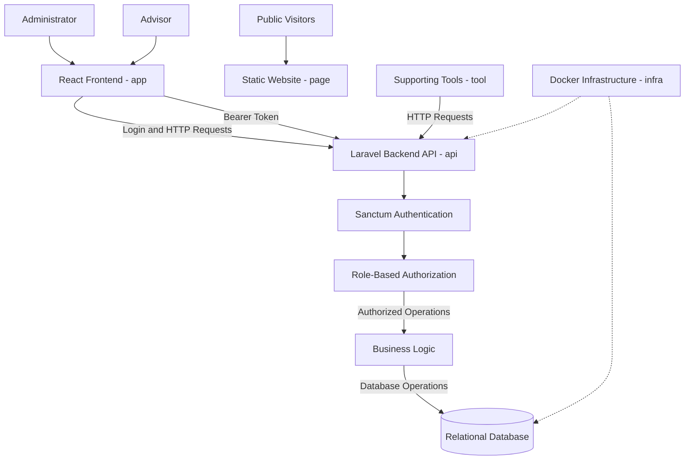


# RENT-TOOLS System Architecture

**Project:** RENT-TOOLS  
**Document:** System Architecture  
**Version:** 1.1.0  
**Status:** Draft  
**Domain:** Construction Equipment Rental Management

---

## 1. Introduction

This document describes the logical architecture of RENT-TOOLS.

It defines the main software components, their responsibilities, communication mechanisms, data flow, security controls, and architectural principles.

The architecture is designed to support the management of construction tools, customers, advisors, rentals, returns, inventory availability, authentication, and role-based access control.

The system uses a client-server architecture in which the React frontend communicates with a Laravel backend API. The backend is responsible for business logic, authentication, authorization, data validation, and database operations.

## 2. Architectural Overview

RENT-TOOLS will use a client-server architecture with clearly separated responsibilities.

The system will consist of the following main components:

- React frontend application.
- Laravel backend API.
- Relational database.
- Docker-based infrastructure.
- Static public website.
- Supporting tools for automation and data seeding.
- Technical documentation.

The frontend and supporting tools will communicate with the backend through documented API endpoints.

The backend will manage business rules, authentication, authorization, data validation, and database operations.

The application will implement two authenticated user roles:

- **Administrator:** Responsible for account management and administrative operations.
- **Advisor:** Responsible for authorized operational activities related to tools, customers, rentals, and returns.

Customers will be registered as business entities and will not have system accounts or authentication credentials.

## 3. Architecture Components

### 3.1 Frontend Application (`app/`)

**Technology:** React.

The frontend is responsible for providing the system's operational user interface.

Main responsibilities:

- Display application interfaces.
- Allow authenticated users to interact with authorized modules.
- Provide login and logout interfaces.
- Send authentication and operational requests to the backend API.
- Include the authentication token in protected API requests.
- Display information returned by the API.
- Handle API responses and errors.
- Display user-facing messages in Spanish.
- Adapt navigation and available interface actions according to the authenticated user's role.

The frontend may hide or disable interface elements according to the user's role. However, frontend restrictions must not be considered a security mechanism by themselves.

All protected operations must be authorized by the backend API.

### 3.2 Backend API (`api/`)

**Technology:** PHP with Laravel.  
**Authentication:** Laravel Sanctum.

The backend is responsible for processing application operations and enforcing business rules and security policies.

Main responsibilities:

- Expose documented API endpoints.
- Validate incoming requests.
- Authenticate users through Laravel Sanctum.
- Identify the authenticated user.
- Verify user roles and permissions.
- Manage tools, customers, and advisors.
- Manage tool categories as an Administrator-only catalogue operation.
- Process rental operations.
- Process return operations.
- Control inventory availability.
- Enforce customer rental restrictions.
- Protect historical information.
- Manage database transactions.
- Handle concurrent rental operations.
- Manage user accounts and role assignments according to permissions.
- Return appropriate HTTP responses.

The backend is the authoritative component for business rule enforcement, authentication, and authorization.

### 3.3 Relational Database

**Technology:** Relational database managed through Docker.

The database stores the information required by the application.

It must support information related to:

- User accounts and assigned roles.
- Advisors.
- Tools.
- Customers.
- Tool categories.
- Rentals.
- Returns.
- Inventory availability.
- Historical transactions.
- Authentication tokens managed through Laravel Sanctum.

The database must preserve data integrity and support transactional operations.

Customer records must remain separate from authenticated user accounts because customers do not access the application directly.

### 3.4 Infrastructure (`infra/`)

**Technology:** Docker.

The infrastructure component contains the configuration required to run the application services.

Main responsibilities:

- Define container configuration.
- Configure database services.
- Manage environment configuration.
- Support consistent application startup.
- Allow the required containers to start using a single command.

Sensitive credentials must remain outside the version-controlled source code.

### 3.5 Public Website (`page/`)

**Technology:** Static web technologies.

The public website presents information about RENT-TOOLS.

Main responsibilities:

- Present the system and its purpose.
- Display relevant public information.
- Provide an accessible public interface.
- Operate independently of the authenticated application interface.

The public website does not provide access to protected operational functions.

### 3.6 Supporting Tools (`tool/`)

This component contains utilities that support development and application operation.

Main responsibilities:

- Provide supporting scripts and automation.
- Implement the initial data seeding process.
- Communicate with the backend through the API.
- Support repeatable data preparation activities.

The data seeding process must use the API instead of directly modifying application data outside the defined interfaces.

### 3.7 Documentation (`docs/`)

This component contains the technical documentation of RENT-TOOLS.

Main responsibilities:

- Maintain project requirements.
- Describe the system architecture.
- Document the data model.
- Define API contracts.
- Organize technical tasks.
- Record architectural decisions.

## 4. System Communication

The main application communication flow is based on HTTP requests and documented API endpoints.

The communication process follows these steps:

1. The user interacts with the React frontend.
2. The frontend sends an HTTP request to the Laravel API.
3. For protected operations, the frontend includes the authentication token.
4. The backend authenticates the request when required.
5. The backend verifies the user's permissions according to the assigned role.
6. The backend validates the request and applies the required business rules.
7. The backend performs database operations when necessary.
8. The backend returns an HTTP response.
9. The frontend displays the corresponding result to the user.

Supporting tools must follow the same API communication principles when interacting with the application.

### 4.1 Authentication Communication

The authentication process will use Laravel Sanctum with API tokens.

The login process follows these steps:

1. The user enters their credentials in the React login interface.
2. The frontend sends the credentials to the Laravel authentication endpoint.
3. The backend validates the credentials.
4. If the credentials are valid, Laravel Sanctum issues an authentication token.
5. The backend returns the authentication result and the information required by the frontend.
6. The frontend uses the token in subsequent protected requests.

Protected requests must include the following HTTP header:

`Authorization: Bearer <token>`

The logout process must revoke the authenticated token through the backend.

### 4.2 Authorization Communication

After authenticating a request, the backend must verify whether the user has permission to execute the requested operation.

The authorization process follows these steps:

1. Laravel identifies the authenticated user.
2. The backend retrieves the user's assigned role.
3. The backend evaluates the permissions associated with the requested operation.
4. If the operation is authorized, the request continues.
5. If the user is authenticated but does not have permission, the backend returns HTTP `403 Forbidden`.
6. If authentication is missing or invalid, the backend returns HTTP `401 Unauthorized`.

The frontend may adapt its navigation and actions according to the role, but the backend must independently enforce every permission.

## 5. Logical Architecture Diagram

The following diagram represents the main components and their communication relationships.

## 6. Data Flow

The application must follow a centralized data management process.

### 6.1 Authentication Flow

1. An Administrator or Advisor accesses the React application.
2. The user submits their credentials through the login interface.
3. The frontend sends the credentials to the backend.
4. Laravel validates the credentials.
5. Laravel Sanctum generates an authentication token when authentication succeeds.
6. The backend returns the authenticated user's information and token.
7. The frontend uses the token for protected requests.
8. The backend validates the token before processing protected operations.

### 6.2 Role-Based Authorization Flow

1. An authenticated user requests an application operation.
2. The frontend sends the request with the authentication token.
3. The backend validates the token.
4. The backend identifies the user's assigned role.
5. The backend checks the permissions required by the operation.
6. If the role has permission, the backend executes the operation.
7. If the role does not have permission, the backend returns HTTP `403 Forbidden`.

### 6.3 Account Management Flow

1. An authenticated Administrator accesses user management.
2. The Administrator submits a request to create a user account.
3. The frontend sends the request to the backend.
4. The backend verifies that the authenticated user has the Administrator role.
5. The backend validates the account information and assigned role.
6. The backend creates the account and stores the password securely.
7. The backend returns the operation result.

Advisors must not be able to create accounts, assign roles, or modify user permissions.

Customers are registered through the customer management functionality and do not receive authentication credentials.

### 6.4 Rental Operation

1. An authenticated advisor submits a rental request through the frontend.
2. The frontend sends the request to the backend.
3. The backend validates the authenticated user's permissions.
4. The backend validates the customer and requested tools.
5. The backend verifies rental restrictions and inventory availability.
6. The backend executes the required database transaction.
7. The backend updates availability and records the rental.
8. The backend returns the operation result to the frontend.

### 6.5 Return Operation

1. An authenticated advisor submits a return request.
2. The frontend sends the request to the backend.
3. The backend validates the authenticated user's permissions.
4. The backend validates the rental and return information.
5. The backend records the return.
6. The backend updates the available inventory.
7. The backend returns the operation result.

## 7. Business Rules and Data Integrity

The architecture must ensure that business rules are enforced by the backend.

The following rules must be protected:

- A customer may have a maximum of three tools rented simultaneously without returning them.
- Each rental has a maximum duration of seven days.
- Customers with overdue rentals cannot receive additional tools until the overdue tools are returned.
- Available units must remain between zero and total units.
- Historical rental information must not change when catalog information is modified.
- Rental and return records must be preserved.
- Catalog records must use logical deletion.

Database transactions must protect operations that modify rental records and inventory availability.

## 8. Concurrency Management

The backend must protect rental operations against simultaneous requests.

When multiple advisors attempt to rent the last available unit:

- The backend must validate the current inventory state.
- Database transactions must protect the operation.
- Only one operation may successfully assign the last available unit.
- Conflicting operations must receive HTTP `409 Conflict`.
- Inventory availability must never become negative.

## 9. Security Architecture

The system must apply security controls across its components.

### 9.1 Authentication

Laravel Sanctum will manage API token authentication.

The following principles must be followed:

- Only valid authenticated users may access protected endpoints.
- The system must support login and logout operations.
- Protected requests must include a valid Bearer token.
- Invalid or missing tokens must return HTTP `401 Unauthorized`.
- Authentication tokens must be revoked through the logout operation.
- Passwords must be securely hashed and never stored in plain text.

### 9.2 Role-Based Access Control

The system will implement two authenticated roles:

| Role | Main responsibilities |
|---|---|
| Administrator | Account creation, role assignment, administrative management, and authorized operational functions. |
| Advisor | Tool registration and editing, customer management, rentals, returns, and authorized operational functions. |

The following permission restrictions must be enforced:

- Only Administrators can create user accounts.
- Only Administrators can assign or change user roles.
- Only Administrators can deactivate user accounts.
- Advisors can register and update tools.
- Advisors cannot logically deactivate tools.
- Customers do not have authenticated accounts.

### 9.3 Authorization Enforcement

The backend API must enforce role permissions independently of the frontend.

The system must:

- Validate incoming requests.
- Restrict access to protected operations.
- Apply permissions according to the authenticated user's assigned role.
- Reject unauthorized requests even when sent directly to the API.
- Return HTTP `403 Forbidden` when an authenticated user lacks the required permission.
- Avoid exposing credentials or sensitive information in API responses.
- Keep environment variables and private credentials outside the repository.

## 10. Date and Time Management

The system must use UTC for stored and processed dates and timestamps.

The backend must maintain consistent date handling across application operations and database records.

Messages displayed to users must be written in Spanish.

## 11. Deployment Architecture

The application infrastructure will use Docker containers to support the required services.

The infrastructure configuration must allow the required containers to be started using a single command.

The React application, Laravel backend, relational database, and supporting services must be configured according to their responsibilities.

Authentication and authorization must be handled by the Laravel backend.

The static public website must remain accessible independently of the operational application interface.

## 12. Architectural Constraints

The architecture must comply with the following technical decisions:

| Component | Technology |
|---|---|
| Frontend | React |
| Backend | PHP with Laravel |
| Authentication | Laravel Sanctum |
| Authorization | Role-Based Access Control |
| Database | Relational database |
| Infrastructure | Docker |
| Public Website | Static web technologies |
| Testing | Automated tests |

The architecture must remain consistent with the project scope and the established requirements.

## 13. Architecture Decision Records

Important architectural decisions must be documented through Architecture Decision Records (ADR).

The project must contain at least three ADR documents.

Each ADR must describe:

- The architectural context.
- The problem or decision to address.
- The considered alternatives.
- The selected decision.
- The justification.
- The consequences of the decision.

Decisions related to authentication and role-based authorization must also be documented.

## 14. Architecture Validation

The architecture will be considered adequately implemented when:

- All project components have clearly defined responsibilities.
- The frontend communicates with the backend through documented API endpoints.
- The backend manages business rules and database operations.
- Database transactions protect critical operations.
- Concurrent rental operations are handled correctly.
- Supporting tools communicate with the application through the API.
- The infrastructure supports the required container startup.
- The public website operates independently of the application interface.
- Administrators and Advisors can authenticate successfully.
- Laravel Sanctum protects the required API endpoints.
- The backend validates role permissions for protected operations.
- Unauthorized requests are rejected with the appropriate HTTP response.
- Customers can be registered without creating authentication accounts.
- Only Administrators can create user accounts and assign roles.
- Advisors can register and update tools but cannot deactivate them.

---

**End of System Architecture**

**Project:** RENT-TOOLS  
**Document:** System Architecture  
**Version:** 1.1.0
