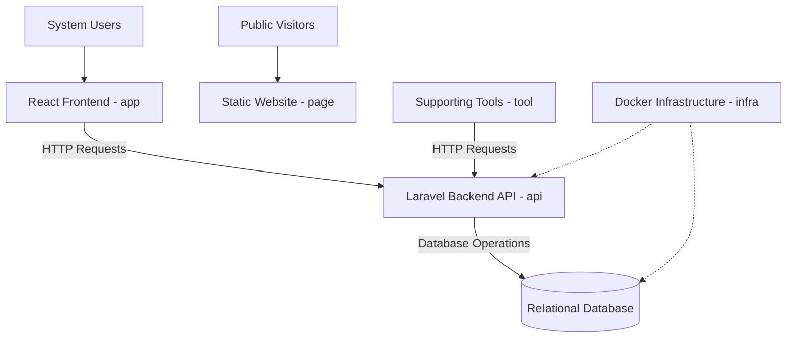

# RENT-TOOLS System Architecture

**Project:** RENT-TOOLS  
**Document:** System Architecture  
**Version:** 1.0.0  
**Status:** Draft  
**Domain:** Construction Equipment Rental Management

---

## 1. Introduction

This document describes the logical architecture of RENT-TOOLS.

It defines the main software components, their responsibilities, communication mechanisms, data flow, and architectural principles.

The architecture is designed to support the management of construction tools, customers, advisors, rentals, returns, and inventory availability.

## 2. Architectural Overview

RENT-TOOLS will use a client-server architecture with clearly separated responsibilities.

The system will consist of the following main components:

- React frontend application.
- Laravel backend API.
- Relational database.
- Docker-based infrastructure.
- Static public website.
- Supporting tools for automation and data seeding.

The frontend and supporting tools will communicate with the backend through documented API endpoints.

The backend will manage business rules, data validation, and database operations.

## 3. Architecture Components

### 3.1 Frontend Application (`app/`)

**Technology:** React.

The frontend is responsible for providing the system's operational user interface.

Main responsibilities:

- Display application interfaces.
- Allow authorized users to interact with the system.
- Send requests to the backend API.
- Display information returned by the API.
- Handle API responses and errors.
- Display user-facing messages in Spanish.

The frontend must not independently enforce critical business rules. These rules must be validated by the backend.

### 3.2 Backend API (`api/`)

**Technology:** PHP with Laravel.

The backend is responsible for processing application operations and enforcing business rules.

Main responsibilities:

- Expose documented API endpoints.
- Validate incoming requests.
- Manage tools, customers, and advisors.
- Process rental operations.
- Process return operations.
- Control inventory availability.
- Enforce customer rental restrictions.
- Protect historical information.
- Manage database transactions.
- Handle concurrent rental operations.
- Return appropriate HTTP responses.

The backend is the authoritative component for business rule enforcement.

### 3.3 Relational Database 

**Technology:** Relational database managed through Docker.

The database stores the information required by the application.

It must support information related to:

- Tools.
- Customers.
- Advisors.
- Rentals.
- Returns.
- Inventory availability.
- Historical transactions.

The database must preserve data integrity and support transactional operations.

### 3.4 Infrastructure (`infra/`)

**Technology:** Docker.

The infrastructure component contains the configuration required to run the application services.

Main responsibilities:

- Define container configuration.
- Configure database services.
- Manage environment configuration.
- Support consistent application startup.
- Allow the required containers to start using a single command.

Sensitive credentials must remain outside the version-controlled source code.

### 3.5 Public Website (`page/`)

**Technology:** Static web technologies.

The public website presents information about RENT-TOOLS.

Main responsibilities:

- Present the system and its purpose.
- Display relevant public information.
- Provide an accessible public interface.
- Operate independently of the authenticated application interface.

### 3.6 Supporting Tools (`tool/`)

This component contains utilities that support development and application operation.

Main responsibilities:

- Provide supporting scripts and automation.
- Implement the initial data seeding process.
- Communicate with the backend through the API.
- Support repeatable data preparation activities.

The data seeding process must use the API instead of directly modifying application data outside the defined interfaces.

### 3.7 Documentation (`docs/`)

This component contains the technical documentation of RENT-TOOLS.

Main responsibilities:

- Maintain project requirements.
- Describe the system architecture.
- Document the data model.
- Define API contracts.
- Organize technical tasks.
- Record architectural decisions.

## 4. System Communication

The main application communication flow is based on HTTP requests and documented API endpoints.

The communication process follows these steps:

1. The user interacts with the React frontend.
2. The frontend sends an HTTP request to the Laravel API.
3. The backend validates the request.
4. The backend applies the required business rules.
5. The backend performs database operations when necessary.
6. The backend returns an HTTP response.
7. The frontend displays the corresponding result to the user.

Supporting tools must follow the same API communication principles when interacting with the application.

## 5. Logical Architecture Diagram

The following diagram represents the main components and their communication relationships.

## 6. Data Flow

The application must follow a centralized data management process.

### 6.1 Rental Operation

1. An advisor submits a rental request through the frontend.
2. The frontend sends the request to the backend.
3. The backend validates the customer and requested tools.
4. The backend verifies rental restrictions and inventory availability.
5. The backend executes the required database transaction.
6. The backend updates availability and records the rental.
7. The backend returns the operation result to the frontend.

### 6.2 Return Operation

1. An advisor submits a return request.
2. The frontend sends the request to the backend.
3. The backend validates the rental and return information.
4. The backend records the return.
5. The backend updates the available inventory.
6. The backend returns the operation result.

## 7. Business Rules and Data Integrity

The architecture must ensure that business rules are enforced by the backend.

The following rules must be protected:

- A customer may have a maximum of three tools rented simultaneously without returning them.
- Each rental has a maximum duration of seven days.
- Customers with overdue rentals cannot receive additional tools until the overdue tools are returned.
- Available units must remain between zero and total units.
- Historical rental information must not change when catalog information is modified.
- Rental and return records must be preserved.
- Catalog records must use logical deletion.

Database transactions must protect operations that modify rental records and inventory availability.

## 8. Concurrency Management

The backend must protect rental operations against simultaneous requests.

When multiple advisors attempt to rent the last available unit:

- The backend must validate the current inventory state.
- Database transactions must protect the operation.
- Only one operation may successfully assign the last available unit.
- Conflicting operations must receive HTTP 409 Conflict.
- Inventory availability must never become negative.

## 9. Security Architecture

The system must apply security controls across its components.

The following principles must be considered:

- Validate incoming requests.
- Restrict access to protected operations.
- Apply permissions according to assigned user roles.
- Protect sensitive configuration information.
- Avoid exposing credentials in API responses.
- Keep environment variables and private credentials outside the repository.

## 10. Date and Time Management

The system must use UTC for stored and processed dates and timestamps.

The backend must maintain consistent date handling across application operations and database records.

Messages displayed to users must be written in Spanish.

## 11. Deployment Architecture

The application infrastructure will use Docker containers to support the required services.

The infrastructure configuration must allow the required containers to be started using a single command.

The React application, Laravel backend, relational database, and supporting services must be configured according to their responsibilities.

The static public website must remain accessible independently of the operational application interface.

## 12. Architectural Constraints

The architecture must comply with the following technical decisions:

| Component | Technology |
|---|---|
| Frontend | React |
| Backend | PHP with Laravel |
| Database | Relational database |
| Infrastructure | Docker |
| Public Website | Static web technologies |
| Testing | Automated tests |

The architecture must remain consistent with the project scope and the approved requirements.

## 13. Architecture Decision Records

Important architectural decisions must be documented through Architecture Decision Records (ADR).

The project must contain at least three ADR documents.

Each ADR must describe:

- The architectural context.
- The problem or decision to address.
- The considered alternatives.
- The selected decision.
- The justification.
- The consequences of the decision.

## 14. Architecture Validation

The architecture will be considered adequately implemented when:

- All six project components have clearly defined responsibilities.
- The frontend communicates with the backend through documented API endpoints.
- The backend manages business rules and database operations.
- Database transactions protect critical operations.
- Concurrent rental operations are handled correctly.
- Supporting tools communicate with the application through the API.
- The infrastructure supports the required container startup.
- The public website operates independently of the application interface.

