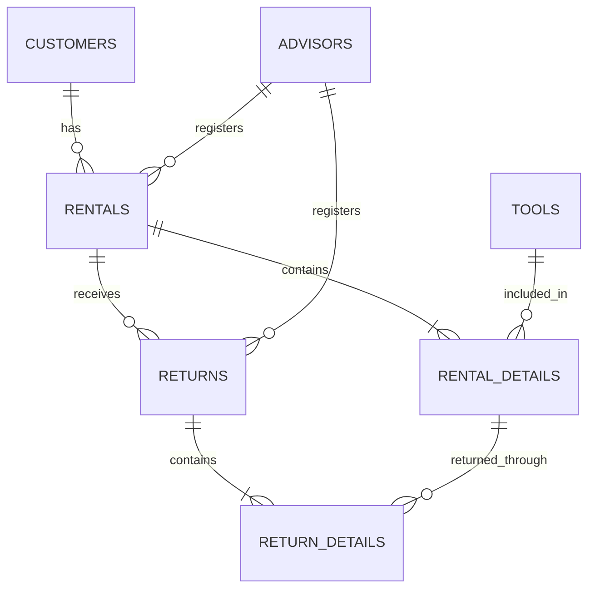

# RENT-TOOLS Data Model

**Project:** RENT-TOOLS  
**Document:** Data Model  
**Version:** 1.0.0  
**Status:** Draft  
**Domain:** Construction Equipment Rental Management

---

## 1. Introduction

This document defines the logical data model for RENT-TOOLS.

It describes the main entities, their attributes, relationships, primary keys, foreign keys, and data integrity constraints required to manage construction tool rentals.

The data model supports tool management, customer management, advisor management, rentals, returns, inventory availability, and historical records.

## 2. Data Modeling Principles

The data model must follow these principles:

- Use primary keys to identify each record uniquely.
- Use foreign keys to maintain relationships between entities.
- Preserve historical rental and return information.
- Maintain inventory consistency.
- Use logical deletion for catalog records.
- Store and process dates and timestamps in UTC.
- Apply database transactions to critical rental and return operations.
- Prevent invalid inventory quantities.

## 3. Main Entities

The system will contain the following main entities:

1. `tools`
2. `customers`
3. `advisors`
4. `rentals`
5. `rental_details`
6. `returns`
7. `return_details`

### 3.1 Tools

**Purpose:** Store information about the construction tools available for rental.

| Attribute | Logical Type | Constraints |
|---|---|---|
| id | Integer | Primary key |
| name | String | Required |
| description | Text | Optional |
| total_quantity | Integer | Required, greater than or equal to zero |
| available_quantity | Integer | Required, between zero and total_quantity |
| created_at | Timestamp | Required, UTC |
| updated_at | Timestamp | Required, UTC |
| deleted_at | Timestamp | Nullable, UTC |

The `deleted_at` attribute supports logical deletion.

Tools with rental history must not be physically deleted.

### 3.2 Customers

**Purpose:** Store information about customers who rent construction tools.

| Attribute | Logical Type | Constraints |
|---|---|---|
| id | Integer | Primary key |
| full_name | String | Required |
| identification_number | String | Required, unique |
| phone | String | Required |
| email | String | Optional |
| created_at | Timestamp | Required, UTC |
| updated_at | Timestamp | Required, UTC |
| deleted_at | Timestamp | Nullable, UTC |

Customer records must remain available when they are associated with historical rentals.

### 3.3 Advisors

**Purpose:** Store information about employees responsible for managing rental and return operations.

| Attribute | Logical Type | Constraints |
|---|---|---|
| id | Integer | Primary key |
| full_name | String | Required |
| identification_number | String | Required, unique |
| email | String | Required |
| created_at | Timestamp | Required, UTC |
| updated_at | Timestamp | Required, UTC |
| deleted_at | Timestamp | Nullable, UTC |

Advisors are associated with the rental and return operations they register.

### 3.4 Rentals

**Purpose:** Represent the main rental transaction associated with a customer and an advisor.

| Attribute | Logical Type | Constraints |
|---|---|---|
| id | Integer | Primary key |
| customer_id | Integer | Foreign key |
| advisor_id | Integer | Foreign key |
| rental_date | Timestamp | Required, UTC |
| due_date | Timestamp | Required, UTC |
| status | String | Required |
| created_at | Timestamp | Required, UTC |
| updated_at | Timestamp | Required, UTC |

The rental status must use one of the following values:

- `active`: No tools have been returned.
- `partially_returned`: At least one tool has been returned, but some units remain outstanding.
- `completed`: All rented units have been returned.

An overdue rental is identified by comparing the current UTC date and time with `due_date`, provided that outstanding units remain.

The due date must be later than the rental date and must not exceed seven calendar days after the rental date. The backend must validate this condition before registering the rental.

### 3.5 Rental Details

**Purpose:** Store the tools and quantities associated with each rental.

| Attribute | Logical Type | Constraints |
|---|---|---|
| id | Integer | Primary key |
| rental_id | Integer | Foreign key |
| tool_id | Integer | Foreign key |
| tool_name_snapshot | String | Required |
| quantity | Integer | Required, greater than zero |
| created_at | Timestamp | Required, UTC |

The `tool_name_snapshot` attribute preserves the tool name at the moment of the rental.

This prevents historical rental information from changing when the tool catalog is modified.

The quantity must be included when validating customer rental restrictions and inventory availability.

The maximum number of outstanding physical tool units per customer is three. The system must calculate this value by adding the rented quantities and subtracting all quantities already returned across the customer's rentals. A new rental must be rejected if it would cause the customer to exceed three outstanding units.

### 3.6 Returns

**Purpose:** Represent the return operation associated with a rental.

| Attribute | Logical Type | Constraints |
|---|---|---|
| id | Integer | Primary key |
| rental_id | Integer | Foreign key |
| advisor_id | Integer | Foreign key |
| return_date | Timestamp | Required, UTC |
| created_at | Timestamp | Required, UTC |

A rental may have multiple return operations when tools are returned at different times.

Every `rental_detail_id` included in a return must belong to the same rental identified by `returns.rental_id`. The backend must validate this relationship before registering a return.

### 3.7 Return Details

**Purpose:** Record the tools and quantities included in each return operation.

| Attribute | Logical Type | Constraints |
|---|---|---|
| id | Integer | Primary key |
| return_id | Integer | Foreign key |
| rental_detail_id | Integer | Foreign key |
| returned_quantity | Integer | Required, greater than zero |
| created_at | Timestamp | Required, UTC |

The returned quantity must not exceed the outstanding quantity associated with the original rental detail.

Return records must be preserved as historical information.

## 4. Entity Relationships

The main entity relationships are:

| Relationship | Cardinality | Description |
|---|---|---|
| Customer - Rental | One-to-Many | A customer may have multiple rentals. |
| Advisor - Rental | One-to-Many | An advisor may register multiple rentals. |
| Rental - Rental Details | One-to-Many | A rental may contain multiple tool details. |
| Tool - Rental Details | One-to-Many | A tool may appear in multiple rental details. |
| Rental - Returns | One-to-Many | A rental may have multiple return operations. |
| Advisor - Returns | One-to-Many | An advisor may register multiple returns. |
| Return - Return Details | One-to-Many | A return may contain multiple returned tool details. |
| Rental Details - Return Details | One-to-Many | A rental detail may be returned through multiple return operations. |

## 5. Entity Relationship Diagram

The following diagram represents the logical relationships between the main entities.

## 6. Primary Keys and Foreign Keys

Primary keys identify records uniquely.

The following foreign key relationships must be maintained:

- `rentals.customer_id` references `customers.id`.
- `rentals.advisor_id` references `advisors.id`.
- `rental_details.rental_id` references `rentals.id`.
- `rental_details.tool_id` references `tools.id`.
- `returns.rental_id` references `rentals.id`.
- `returns.advisor_id` references `advisors.id`.
- `return_details.return_id` references `returns.id`.
- `return_details.rental_detail_id` references `rental_details.id`.

Foreign key constraints must prevent invalid references.

## 7. Data Integrity Constraints

The database must maintain the following integrity rules:

1. Available tool quantities must never be negative.
2. Available quantities must never exceed total quantities.
3. Rental detail quantities must be greater than zero.
4. Returned quantities must be greater than zero.
5. Returned quantities must not exceed the outstanding quantity of the original rental detail.
6. Rental due dates must be later than rental dates and must not exceed seven calendar days after the rental date.
7. Each customer must have no more than three outstanding physical tool units across all rentals.
8. Customer rental restrictions must be validated before registering new rentals.
9. Every return detail must reference a rental detail belonging to the rental associated with that return.
10. Historical rental and return records must be preserved.
11. Catalog records must use logical deletion.
12. Critical inventory changes must be protected by database transactions.

## 8. Inventory Management

The `tools` entity maintains the total and available quantities.

When a rental is registered:

- The system validates the available quantity.
- The system decreases the available quantity.
- The rental and its details are recorded.
- The operation is executed within a database transaction.

When a return is registered:

- The system validates the outstanding quantity.
- The system records the return details.
- The available quantity is increased.
- The operation is executed within a database transaction.

The following condition must always remain true:

`0 <= available_quantity <= total_quantity`

## 9. Historical Data Management

Historical records must remain consistent over time.

The system must:

- Preserve rental records.
- Preserve return records.
- Preserve the tool name captured at rental time.
- Avoid changing historical information when catalog records are modified.
- Use logical deletion for catalog entities.
- Prevent physical deletion of records referenced by historical transactions.

## 10. Date and Time Management

All dates and timestamps must be stored and processed in UTC.

The rental date and due date must be used to determine whether a rental is overdue.

The maximum rental duration is seven days.

## 11. Concurrency and Transactions

Rental and return operations must use database transactions.

The system must prevent simultaneous requests from assigning the same available tool unit.

When two advisors attempt to rent the last available unit:

- Only one transaction may successfully complete.
- The other transaction must receive HTTP `409 Conflict`.
- Inventory quantities must remain consistent.

The backend must implement the necessary locking and transaction mechanisms.

## 12. Data Model Validation

The data model will be considered adequately implemented when:

- All required entities are created.
- Primary keys and foreign keys are correctly defined.
- Entity relationships are maintained.
- Inventory constraints are enforced.
- Rental and return history is preserved.
- Logical deletion is implemented for catalog records.
- UTC date handling is maintained.
- Transactions protect critical operations.
- The data model supports the business rules defined in the project specification.

---

**End of Document**

**Project:** RENT-TOOLS  
**Document:** Data Model  
**Version:** 1.0.0

