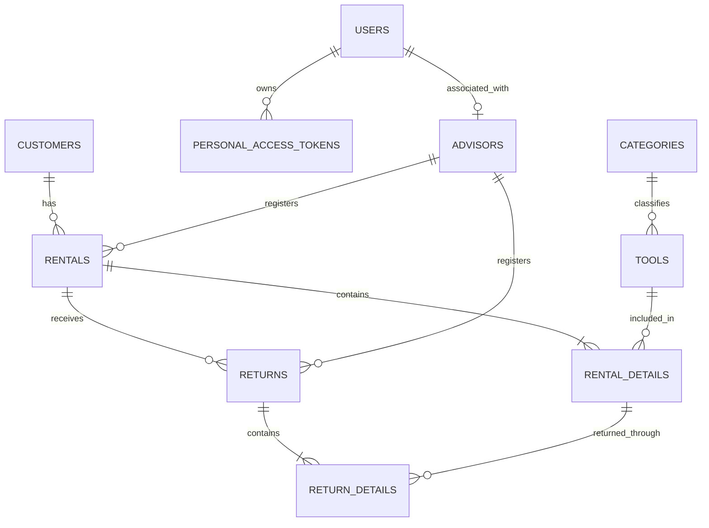


# RENT-TOOLS Data Model

**Project:** RENT-TOOLS  
**Document:** Data Model  
**Version:** 1.1.1  
**Status:** Draft  
**Domain:** Construction Equipment Rental Management

## 1. Introduction

This document defines the logical data model for RENT-TOOLS.

It describes the main entities, their attributes, relationships, primary keys, foreign keys, and data integrity constraints required to manage construction tool rentals.

The data model supports user accounts, role management, tool management, customer management, advisor management, rentals, returns, inventory availability, authentication tokens, and historical records.

## 2. Data Modeling Principles

The data model must follow these principles:

- Use primary keys to identify each record uniquely.
- Use foreign keys to maintain relationships between entities.
- Preserve historical rental and return information.
- Maintain inventory consistency.
- Use logical deletion for tools, customers, advisors, and user accounts when applicable, subject to role-based permissions.
- Store and process dates and timestamps in UTC.
- Apply database transactions to critical rental and return operations.
- Prevent invalid inventory quantities.
- Separate authenticated user accounts from customer business records.
- Store user roles to support role-based access control.
- Support Laravel Sanctum token storage for API authentication.
- Restrict customer logical deactivation to Administrators.
- Prevent physical deletion of customers associated with rental history.

## 3. Main Entities

The system will contain the following main business entities:

1. users
2. tools
3. customers
4. advisors
5. rentals
6. rental_details
7. returns
8. return_details

The authentication mechanism will also use the Laravel Sanctum table:

- personal_access_tokens

This table is managed according to Laravel Sanctum's token storage structure.

### 3.1 Users

**Purpose:** Store the accounts of people authorized to access the RENT-TOOLS application.

Only Administrators and Advisors have authenticated user accounts.

| Attribute | Logical Type | Constraints |
|---|---|---|
| id | Integer | Primary key |
| category_id | Integer | Required foreign key to categories.id |
| name | String | Required |
| email | String | Required, unique |
| password | String | Required, securely hashed |
| role | String | Required, administrator or advisor |
| created_at | Timestamp | Required, UTC |
| updated_at | Timestamp | Required, UTC |
| deleted_at | Timestamp | Nullable, UTC |

The role attribute identifies the user's authorization level.

Allowed values:

- administrator: User with administrative permissions.
- advisor: User with authorized operational permissions.

Only an authenticated Administrator may create user accounts and assign roles.

Users must not be allowed to change their own role.

The deleted_at attribute supports logical account deactivation. Deactivated accounts must not be allowed to authenticate.

Passwords must never be stored in plain text.

Customers must not be registered in this entity because they do not have application accounts.

### 3.2 Tools

**Purpose:** Store information about the construction tools available for rental.

| Attribute | Logical Type | Constraints |
|---|---|---|
| id | Integer | Primary key |
| name | String | Required |
| description | Text | Optional |
| total_quantity | Integer | Required, greater than or equal to zero |
| available_quantity | Integer | Required, between zero and total_quantity |
| created_at | Timestamp | Required, UTC |
| updated_at | Timestamp | Required, UTC |
| deleted_at | Timestamp | Nullable, UTC |

The deleted_at attribute supports logical deletion.

Tools with rental history must not be physically deleted.

Administrators may register, update, and logically deactivate tools.

Advisors may register and update tools but must not logically deactivate them.

### 3.3 Categories

**Purpose:** Classify tools in the operational catalogue. Categories are managed only by Administrators and are not application roles.

| Attribute | Logical Type | Constraints |
|---|---|---|
| id | Integer | Primary key |
| name | String | Required, unique among active categories |
| description | Text | Optional |
| created_at | Timestamp | Required, UTC |
| updated_at | Timestamp | Required, UTC |
| deleted_at | Timestamp | Nullable, UTC; logical deactivation |

Categories referenced by tools must not be physically deleted. Catalogue changes must not alter rental and return snapshots.

### 3.4 Customers

**Purpose:** Store information about customers who rent construction tools.

| Attribute | Logical Type | Constraints |
|---|---|---|
| id | Integer | Primary key |
| full_name | String | Required |
| identification_number | String | Required, unique |
| phone | String | Required |
| email | String | Optional |
| created_at | Timestamp | Required, UTC |
| updated_at | Timestamp | Required, UTC |
| deleted_at | Timestamp | Nullable, UTC |

Customer records must remain available when they are associated with historical rentals.

Customers are business entities and do not have application user accounts, passwords, authentication tokens, or system roles.

Customer management permissions are defined as follows:

- Administrators may register, consult, update, and logically deactivate customers.
- Advisors may register, consult, and update customers.
- Advisors must not logically deactivate customers.
- Only Administrators may execute customer deactivation.
- If an Advisor attempts to deactivate a customer, the backend must reject the operation with HTTP 403 Forbidden.
- Customer deactivation must be performed through the deleted_at attribute.
- Customer records must not be physically deleted through the application.
- Customer records associated with historical rentals must remain available for consultation.
- A deactivated customer must not be allowed to receive a new rental until an Administrator reactivates the record.
- Customer reactivation must also be restricted to Administrators.

The database must preserve the relationship between customers and their historical rental records, even when a customer is deactivated.

### 3.5 Advisors

**Purpose:** Store information about employees responsible for managing rental and return operations.

| Attribute | Logical Type | Constraints |
|---|---|---|
| id | Integer | Primary key |
| user_id | Integer | Nullable, unique foreign key to users.id |
| full_name | String | Required |
| identification_number | String | Required, unique |
| email | String | Required |
| created_at | Timestamp | Required, UTC |
| updated_at | Timestamp | Required, UTC |
| deleted_at | Timestamp | Nullable, UTC |

The user_id attribute links an advisor business record to an authenticated user account.

The relationship is one-to-one when an advisor account is associated with an advisor record.

The unique constraint prevents an account from being linked to multiple advisor records.

The field is nullable to allow an advisor business record to exist independently when an account has not yet been associated.

When an advisor is authorized to access the application, the corresponding user account must have the advisor role.

Advisors are associated with the rental and return operations they register.

### 3.6 Rentals

**Purpose:** Represent the main rental transaction associated with a customer and an advisor.

| Attribute | Logical Type | Constraints |
|---|---|---|
| id | Integer | Primary key |
| customer_id | Integer | Foreign key |
| advisor_id | Integer | Foreign key |
| rental_date | Timestamp | Required, UTC |
| due_date | Timestamp | Required, UTC |
| status | String | Required |
| created_at | Timestamp | Required, UTC |
| updated_at | Timestamp | Required, UTC |

The rental status must use one of the following values:

- active: No tools have been returned.
- partially_returned: At least one tool has been returned, but some units remain outstanding.
- completed: All rented units have been returned.

An overdue rental is identified by comparing the current UTC date and time with due_date, provided that outstanding units remain.

The due date must be later than the rental date and must not exceed seven calendar days after the rental date. The backend must validate this condition before registering the rental.

Only active customers may be associated with new rental operations.

The advisor_id attribute identifies the advisor responsible for registering the rental.

### 3.7 Rental Details

**Purpose:** Store the tools and quantities associated with each rental.

| Attribute | Logical Type | Constraints |
|---|---|---|
| id | Integer | Primary key |
| rental_id | Integer | Foreign key |
| tool_id | Integer | Foreign key |
| tool_name_snapshot | String | Required |
| quantity | Integer | Required, greater than zero |
| created_at | Timestamp | Required, UTC |

The tool_name_snapshot attribute preserves the tool name at the moment of the rental.

This prevents historical rental information from changing when the tool catalog is modified.

The quantity must be included when validating customer rental restrictions and inventory availability.

The maximum number of outstanding physical tool units per customer is three. The system must calculate this value by adding the rented quantities and subtracting all quantities already returned across the customer's rentals. A new rental must be rejected if it would cause the customer to exceed three outstanding units.

### 3.8 Returns

**Purpose:** Represent the return operation associated with a rental.

| Attribute | Logical Type | Constraints |
|---|---|---|
| id | Integer | Primary key |
| rental_id | Integer | Foreign key |
| advisor_id | Integer | Foreign key |
| return_date | Timestamp | Required, UTC |
| created_at | Timestamp | Required, UTC |

A rental may have multiple return operations when tools are returned at different times.

Every rental_detail_id included in a return must belong to the same rental identified by returns.rental_id. The backend must validate this relationship before registering a return.

The advisor_id attribute identifies the advisor responsible for registering the return.

### 3.9 Return Details

**Purpose:** Record the tools and quantities included in each return operation.

| Attribute | Logical Type | Constraints |
|---|---|---|
| id | Integer | Primary key |
| return_id | Integer | Foreign key |
| rental_detail_id | Integer | Foreign key |
| returned_quantity | Integer | Required, greater than zero |
| created_at | Timestamp | Required, UTC |

The returned quantity must not exceed the outstanding quantity associated with the original rental detail.

Return records must be preserved as historical information.

### 3.10 Personal Access Tokens

**Purpose:** Store authentication tokens generated and managed by Laravel Sanctum.

The personal_access_tokens table follows Laravel Sanctum's standard polymorphic token structure.

Its main logical attributes include:

| Attribute | Logical Type | Constraints |
|---|---|---|
| id | Integer | Primary key |
| tokenable_type | String | Required |
| tokenable_id | Integer | Required, identifies the token owner |
| name | String | Required |
| token | String | Required, unique token hash |
| abilities | Text / JSON | Optional |
| last_used_at | Timestamp | Nullable, UTC |
| expires_at | Timestamp | Nullable, UTC |
| created_at | Timestamp | Required, UTC |
| updated_at | Timestamp | Required, UTC |

The tokenable_type and tokenable_id attributes identify the model associated with the token.

For RENT-TOOLS, authentication tokens are associated with user accounts.

Tokens must be managed and revoked through Laravel Sanctum.

The application must not store raw authentication tokens as plain text in the database.

Customers must never receive authentication tokens because they do not have application accounts.

## 4. Entity Relationships

The main entity relationships are:

| Relationship | Cardinality | Description |
|---|---|---|
| User - Advisor | One-to-One, optional | An advisor record may be associated with one user account. |
| Category - Tool | One-to-Many | A category may classify multiple tools. |
| Customer - Rental | One-to-Many | A customer may have multiple rentals. |
| Advisor - Rental | One-to-Many | An advisor may register multiple rentals. |
| Rental - Rental Details | One-to-Many | A rental may contain multiple tool details. |
| Tool - Rental Details | One-to-Many | A tool may appear in multiple rental details. |
| Rental - Returns | One-to-Many | A rental may have multiple return operations. |
| Advisor - Returns | One-to-Many | An advisor may register multiple returns. |
| Return - Return Details | One-to-Many | A return may contain multiple returned tool details. |
| Rental Details - Return Details | One-to-Many | A rental detail may be returned through multiple return operations. |
| User - Personal Access Tokens | One-to-Many | A user may have multiple authentication tokens. |

Customers do not have a relationship with user accounts because they do not authenticate in the application.

Customer deactivation does not remove or modify the relationship between customers and their historical rentals.

## 5. Entity Relationship Diagram

The following diagram represents the logical relationships between the main entities.



The PERSONAL_ACCESS_TOKENS entity represents the Laravel Sanctum token storage structure. Its actual relationship is polymorphic through tokenable_type and tokenable_id.

## 6. Primary Keys and Foreign Keys

Primary keys identify records uniquely.

The following foreign key relationships must be maintained:

- advisors.user_id references users.id.
- tools.category_id references categories.id.
- rentals.customer_id references customers.id.
- rentals.advisor_id references advisors.id.
- rental_details.rental_id references rentals.id.
- rental_details.tool_id references tools.id.
- returns.rental_id references rentals.id.
- returns.advisor_id references advisors.id.
- return_details.return_id references returns.id.
- return_details.rental_detail_id references rental_details.id.

Laravel Sanctum manages the polymorphic relationship between users and personal_access_tokens through tokenable_type and tokenable_id.

Foreign key constraints must prevent invalid references.

Customer records referenced by rental history must not be physically deleted.

## 7. Data Integrity Constraints

The database and backend must maintain the following integrity rules:

1. Available tool quantities must never be negative.
2. Available quantities must never exceed total quantities.
3. Rental detail quantities must be greater than zero.
4. Returned quantities must be greater than zero.
5. Returned quantities must not exceed the outstanding quantity of the original rental detail.
6. Rental due dates must be later than rental dates and must not exceed seven calendar days after the rental date.
7. Each customer must have no more than three outstanding physical tool units across all rentals.
8. Customer rental restrictions must be validated before registering new rentals.
9. Every return detail must reference a rental detail belonging to the rental associated with that return.
10. Historical rental and return records must be preserved.
11. Catalog records must use logical deletion.
12. Critical inventory changes must be protected by database transactions.
13. User emails must be unique.
14. User roles must be restricted to administrator and advisor.
15. Only Administrators may create user accounts and assign roles.
16. Customers must not have authenticated user accounts.
17. Advisor accounts must use the advisor role.
18. Deactivated user accounts must not be allowed to authenticate.
19. Authentication tokens must be associated with valid user accounts and managed through Laravel Sanctum.
20. Customers must support logical deactivation through the deleted_at attribute.
21. Only Administrators may logically deactivate customers.
22. Advisors must not be allowed to deactivate customers.
23. An attempt by an Advisor to deactivate a customer must return HTTP 403 Forbidden.
24. Only Administrators may reactivate deactivated customers.
25. Deactivated customers must not be associated with new rental operations.
26. Customer records must not be physically deleted through the application.
27. Customer deactivation must not delete or modify historical rental and return records.
28. Customer identification numbers must be unique.
29. The backend must enforce customer permissions independently of frontend restrictions.

## 8. Inventory Management

The tools entity maintains the total and available quantities.

When a rental is registered:

- The system validates the available quantity.
- The system decreases the available quantity.
- The rental and its details are recorded.
- The operation is executed within a database transaction.

When a return is registered:

- The system validates the outstanding quantity.
- The system records the return details.
- The available quantity is increased.
- The operation is executed within a database transaction.

The following condition must always remain true:

```text
0 <= available_quantity <= total_quantity
```

## 9. Historical Data Management

Historical records must remain consistent over time.

The system must:

- Preserve rental records.
- Preserve return records.
- Preserve the tool name captured at rental time.
- Avoid changing historical information when catalog records are modified.
- Use logical deletion for catalog entities.
- Prevent physical deletion of records referenced by historical transactions.
- Preserve the relationship between advisor records and the operations they registered.
- Preserve customer records associated with historical rentals.
- Allow authorized users to consult historical rental information even when a customer has been deactivated.
- Prevent customer deactivation from deleting or modifying rental and return records.
- Preserve the historical information associated with deactivated user accounts and advisors.

User account deactivation must not physically delete historical rental or return records.

Customer deactivation must be performed logically through the deleted_at attribute and must not physically delete the customer record.

## 10. Date and Time Management

All dates and timestamps must be stored and processed in UTC.

The rental date and due date must be used to determine whether a rental is overdue.

The maximum rental duration is seven days.

Authentication token timestamps must also use UTC.

## 11. Concurrency and Transactions

Rental and return operations must use database transactions.

The system must prevent simultaneous requests from assigning the same available tool unit.

When two advisors attempt to rent the last available unit:

- Only one transaction may successfully complete.
- The other transaction must receive HTTP 409 Conflict.
- Inventory quantities must remain consistent.

The backend must implement the necessary locking and transaction mechanisms.

Customer rental restrictions must also be validated within the rental registration process to prevent concurrent requests from exceeding the maximum number of outstanding physical tool units.

## 12. Data Model Validation

The data model will be considered adequately implemented when:

- All required entities are created.
- Primary keys and foreign keys are correctly defined.
- Entity relationships are maintained.
- User accounts support the two authorized roles.
- Advisor records can be associated with user accounts.
- Customers remain independent of authentication accounts.
- Laravel Sanctum token storage is configured.
- Inventory constraints are enforced.
- Rental and return history is preserved.
- Logical deletion is implemented for catalog records and user accounts when applicable.
- Customer logical deactivation is implemented.
- Only Administrators can deactivate and reactivate customers.
- Advisors can register, consult, and update customers but cannot deactivate them.
- Customer deactivation attempts by Advisors are rejected with HTTP 403 Forbidden.
- Physical deletion of customer records is prevented through the application.
- Deactivated customers cannot receive new rentals.
- Customer historical rental and return information remains preserved after deactivation.
- UTC date handling is maintained.
- Transactions protect critical operations.
- The data model supports the business rules defined in the project specification.
- The data model supports the authorization requirements established for Administrators and Advisors.

---

**End of Document**

**Project:** RENT-TOOLS  
**Document:** Data Model  
**Version:** 1.1.1
